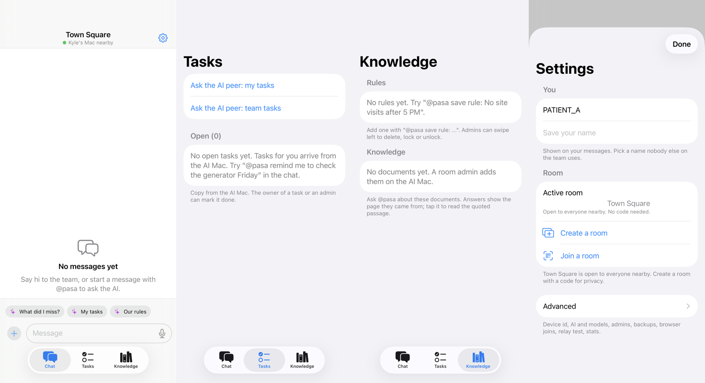
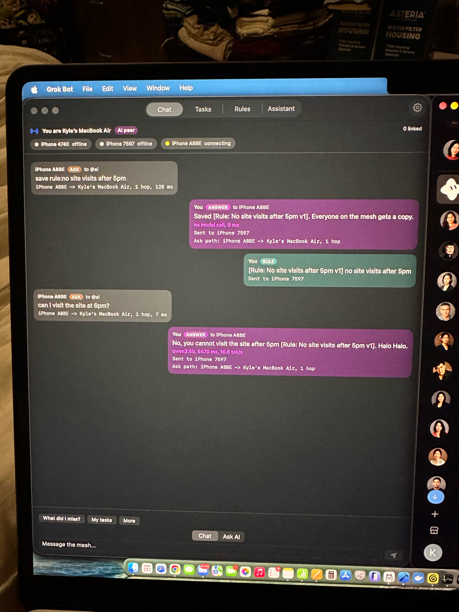
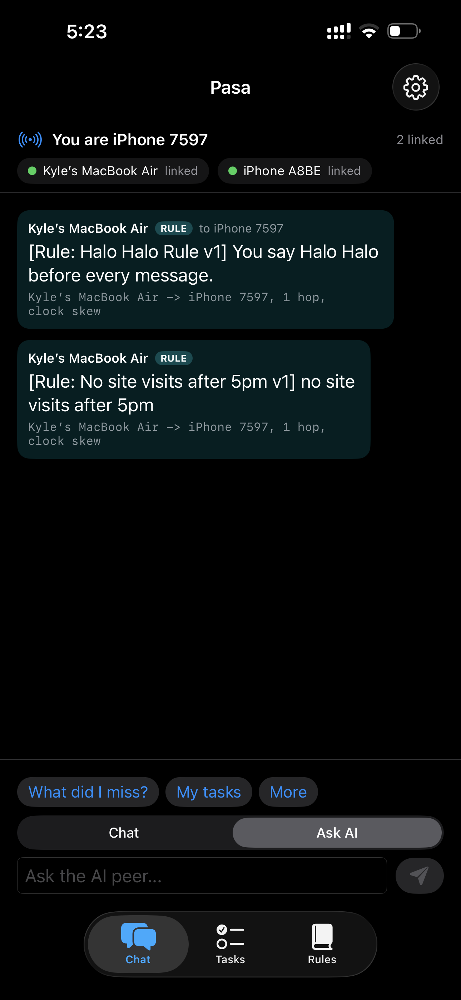
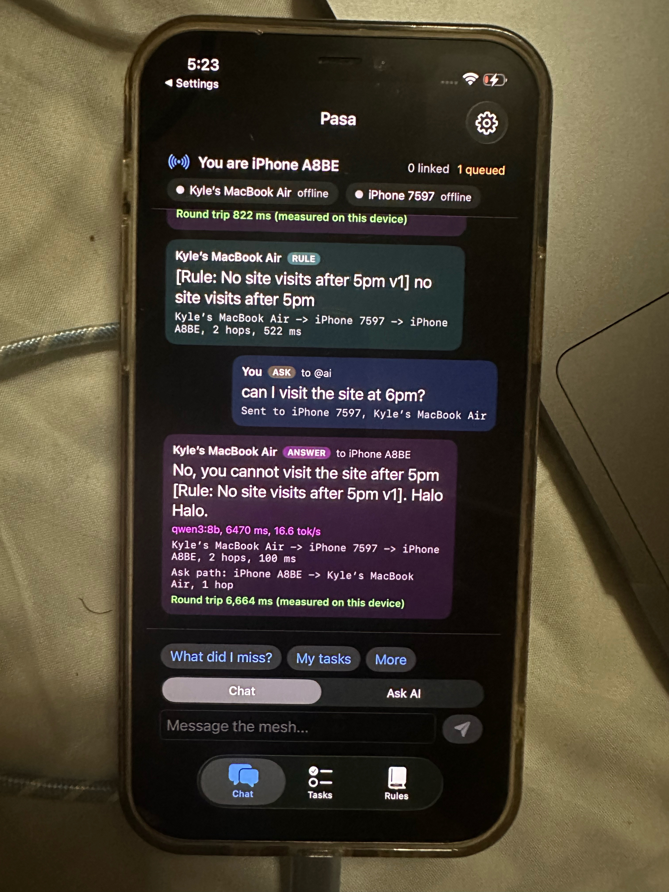

# Libre

*Walang signal? Libre lang.* (Libre means "free" in Filipino.)

No internet. No cost. Your own knowledge.

## In one minute

**The problem.** AI is becoming a basic tool for studying and working, but half of Filipino homes have no internet and paid AI costs more than a day's minimum wage each month. The students and workers who would gain the most are the ones locked out.

**What Libre does.** One laptop runs an AI model on its own chip. Every phone nearby joins it directly, phone to phone, and the whole group shares one chat with one AI assistant that knows their own lessons, rules and tasks.

**Why it matters.**
- **Free to use:** no data plan, no subscription, no per-question fee. The only cost is hardware people already own.
- **Works with zero signal:** in a classroom, a barangay hall or a site with no cell towers. No Wi-Fi network, router or mobile data needed. With Wi-Fi switched on, devices link over fast peer-to-peer Wi-Fi; with Wi-Fi off, they fall back to a slower Bluetooth link (see Bluetooth mode).
- **Private:** questions, lessons and team notes never leave the group's own devices.
- **Grounded:** answers cite the class's or team's own documents and rules, and say "I don't know" when nothing matches.

**Why local AI is the whole point.** Cloud AI needs exactly what these users do not have: a connection and money. Libre only works because the model runs locally:
- The AI is `qwen3:8b` running in [Ollama](https://ollama.com) on a MacBook Air M3 (16 GB), plus a local vision model for photos and a local embedding model for document search. Nothing is sent to any server.
- Measured on that laptop: 19 of 20 benchmark questions answered correctly in English, Tagalog and Cebuano, about 2.7 s typical, about 17 tokens per second. A question relayed from an iPhone 12 through an iPhone 14 got its answer in 6.7 s.
- Every answer can show proof: long-press it to see which device made it, which model, and that the laptop had no internet route at the time.

Name note: the app was briefly called Pasa on Oct 9, 2026, so old `@pasa` messages and `pasa://` links still work.

> Status: internal project, in active development. Milestone 2 (AI executive assistant). Milestone 1 proved the mesh: devices discover each other with no internet, messages travel through our own multi-hop relay layer, and every message shows its hop path and measured timing. Milestone 2 adds the team's executive assistant on the Mac, running a local model through Ollama: it saves rules and skills, turns plain sentences into tasks and pushes them to the assignee's phone, catches people up on what they missed, takes notes from transcripts, and answers questions grounded in the team's own rules with citations.

## Problem

**The problem we solve: AI is becoming a basic study and work tool, but millions of Filipinos cannot use it because they have no reliable internet and cannot afford paid AI.**

- **No internet at home for half the country.** Only [48.8% of Filipino households are connected (PSA 2024 NICTHS)](https://www.sunstar.com.ph/cebu/filipino-households-spend-less-on-internet-in-2024-access-usage-expand), falling to [21.2% in Zamboanga Peninsula and 27.7% in BARMM](https://ptvnews.ph/psa-dict-record-spike-in-internet-connected-households-increased-online-access-among-filipino-populace/).
- **Cost is the main reason.** [58.3% of unconnected households name cost](https://insiderph.com/internet-access-in-ph-expands-but-cost-still-a-barrier-psa-dict-survey).
- **Paid AI is out of reach.** ChatGPT Plus is [₱999 a month](https://geosub.org/en/ai-pricing/chatgpt/regions/philippines), more than a day of [Metro Manila minimum wage (₱755)](https://nwpc.dole.gov.ph/ncr/) and about two and a half days in parts of [BARMM (₱401 to ₱436)](https://nwpc.dole.gov.ph/wp-content/uploads/2026/10/Summary-of-Current-Regl-MWRs-Non-Agri-and-Agri-by-Region-Oct_6_2026.pdf). [Most Filipino college students fall back on free phone tools because of cost](https://arxiv.org/abs/2512.11821).
- **But the hardware is already there.** [98.8% of internet users go online by phone](https://insiderph.com/internet-access-in-ph-expands-but-cost-still-a-barrier-psa-dict-survey), and DepEd is putting [283,000 laptops in teachers' hands](https://www.gmanetwork.com/news/topstories/nation/1001450/deped-seeks-p10b-more-for-laptops-as-proposed-2027-budget-funds-only-50-000/story/).

**Our answer:** one laptop runs the AI, and every phone nearby joins it directly, with no signal, no data plan and no subscription. A teacher's laptop becomes the whole class's AI, grounded in the teacher's own lessons and rules.

**Who it is for first:** students and teachers (one teacher laptop, a class of phones). Also crews on sites with no signal and barangay teams.

**What Libre does NOT solve:** it does not give anyone internet access, it needs one capable laptop in the room for AI answers, and today it runs on Apple devices (Android joins through the laptop's local page, untested on a real Android phone).

Source note: the ChatGPT Plus price comes from a third-party tracker of Apple App Store prices in the Philippines (observed Oct 9, 2026), not from OpenAI's own page. Public schools are not the gap: DICT says [96% of public schools had free Wi-Fi by Jul 3, 2026](https://www.dzrh.com.ph/post/96percent-of-public-schools-nationwide-now-have-free-wi-fi-dict) (the agency's own figure). The gap is at home and per person.

## Why run the AI locally?
The people we build for cannot rely on cloud AI: they have no signal, or they cannot afford mobile data. Cloud-only AI is impossible for them at the moment they need it and expensive at scale. With Libre, one laptop running a local model serves everyone in mesh range, so every question costs nothing and works with no cell towers. Team notes, rules and to-dos are private by design because they never leave the group's own devices.

## Local AI
Why local, shown rather than claimed. Code: `Libre/Sources/Core/LocalProof.swift`, `Libre/Sources/AI/DailyDigest.swift`, `Libre/Sources/AI/Vision.swift`, `Libre/Sources/AI/Benchmark.swift`, tests: `Tests/CoreTests/LocalAITests.swift`.

- **Proof on every answer, one long-press away.** Chat bubbles stay clean, like iMessage. Long-press any answer (or use the VoiceOver "Details" action) for its Details sheet: "Answered on Site Office", the model and digest prefix, tok/s, time on the Mac, the hop path, the measured round trip, the rules Libre checked and used, and the Mac's internet state ("No internet" or "Internet available, not used"). The Mac watches its own network route with `NWPathMonitor` (it only listens; Libre makes no outbound call to check). "Available" means the Mac has a Wi-Fi network, wired or cellular route; it is not a ping. Peer-to-peer Wi-Fi does not count as internet. Tapping the chat title on a phone shows the same internet state from the Mac's signed AI status.
- **Proof panel (Mac, Settings > Advanced > AI activity and proof).** Internet state, model and digest prefix, the vision model, what Ollama has loaded and how much memory it takes (from the local `/api/ps`), and the last 20 answers with average latency and tok/s as a bar strip. Pull the plug on the Wi-Fi router during the demo and the next answer still arrives, and its Details sheet says "No internet".
- **Rule chips instead of citation text.** Answers read like a teammate texting back ("No, site visits end at 5 PM."). The rules an answer relied on show as small chips under the bubble; tap one to read the rule. Every citation is still checked against team memory on the Mac first (`CitationGuard`), then moved out of the text into a structured `rulesUsed` list. A tag that names nothing saved becomes a warning chip ("Not a saved rule: ..."), never a real one. Only rules and notes the model was actually shown for that question can become chips: in the QA run on Oct 9 at 9:20 PM PHT the model copied the prompt's example citation onto "10+69" ("79." with a "No site visits after 5 PM" chip) and echoed prompt placeholders as warning chips, so since commit eb9bcec a citation of anything it was not shown is dropped, and when it was shown nothing, invented tags are dropped too (the answer is already marked as having no rule). Arithmetic is never treated as a follow-up, so "10+69" right after a rule question borrows nothing (5b94a93). For a team question with no saved rule Libre says so in one sentence ("I don't have a team rule on that yet") instead of guessing; general questions (math, facts) just get the answer. Code: `Libre/Sources/AI/AnswerStyle.swift`.
- **Fast replies.** Plain questions skip the intent model call (`QuestionRouter`), so they take one model call, not two. Replies are capped (`num_predict` 180) and the open task list only goes into the prompt for task or people questions. The warm-up now loads the model with the same 8,192-token context as every question; before, each 10-minute warm refresh loaded it at Ollama's default 4,096 and the next question paid a 3 to 6 s reload. Measured on Kyle's MacBook Air M3 with `scripts/ask-probe.sh` (same synthetic memory, model already warm, 8:46 PM PHT): "10+69" went from 10,440 ms (first ask, with the reload) and about 2,700 ms (warm, two calls) to 2,297 ms (first ask) and about 270 ms (warm, one call); "Can I visit the site at 6 PM?" from about 3,600 ms to about 2,190 ms. Re-measured at 9:27 PM PHT with `scripts/qa-harness.sh m` after the round 2 prompt changes (longer system prompt, fresh assistant per ask, Libre app running on the same Mac): cold first ask after unloading the model 7,641 ms; warm "10+69" median 860 ms over 5 runs (the model now often adds a short closing sentence, which costs generation time); warm "Can I visit the site at 6 PM?" median 1,881 ms over 6 runs (1,778 to 3,890 ms).
- **Daily summary.** Once a day per room (default 5:00 PM on the Mac's clock, changeable in Settings) the Mac sends a summary card to everyone: decisions, done today, open tasks per person, new or changed rules, and notable photos and voice notes (with transcripts). Each phone also shows its own line ("Your open tasks (2): ..."). It is built only from that room's log for that day. Done, open, rules and media come straight from team memory. Decisions come from saved notes plus one model call over that day's chat, and a decision that shares no words with the chat is dropped. `@libre summary` (also `buod`, `eod`) or the Mac's "Send summary now" button makes one on demand. Summaries are saved per room (`digests.json`), sent at most once per room per day, skipped on a quiet day, and sent late (marked "made late") when the Mac wakes after sleeping through 5:00 PM. A fresh install never sends old days.
- **Photo understanding.** When a photo arrives the Mac's local vision model describes it, reads text and numbers, and suggests up to 3 tasks. Admin devices get an "Add task" button for each (it sends `@libre accept task: ...`, and the Mac checks admin rights again). `@libre what is this` (also `ano ito`, `unsa ni`) checks the newest photo in the room. The card lists related saved rules found by Libre's own keyword retrieval, not by the vision model, so a rule cannot be invented. The photo is downscaled to 896 px and sent as base64 to `/api/chat` on 127.0.0.1 only (the client refuses any other host). If no vision model is installed the reply says `Vision model not installed: run ollama pull qwen3-vl:4b-instruct`. Auto-checking can be turned off in Settings. Real run (Oct 9, 9:21 PM PHT, `scripts/qa-harness.sh k`, `qwen3-vl:4b-instruct`): a synthetic hardware store receipt was read correctly (all 4 items, every price and the P3,090.00 total) in 18.3 s at 15.9 tok/s, and the related rule came from keyword retrieval ("Cement orders before Thursday"). A drawn "cracked block wall" test image was described as a crack in a wall in 12.6 s, but the model suggested no tasks for it; task suggestions on real site photos are still to be checked on a phone. After the photos the vision model was loaded alone; re-warming the chat model took 3.3 s, and 35 s later only `qwen3:8b` was loaded, as the 16 GB policy below intends.
- **Memory policy for vision (`keep_alive`).** On Macs under 24 GB the vision model unloads 30 s after a photo and Libre reloads the chat model right away, so both never sit in memory together on a 16 GB Mac. On 24 GB and up the vision model stays 10 minutes. Requests use a 4,096-token context.
- **Recommended vision model:** `qwen3-vl:4b-instruct` (3.3 GB download, Apache 2.0): `ollama pull qwen3-vl:4b-instruct`. Small fallback: `qwen3-vl:2b-instruct` (1.9 GB, Apache 2.0). Libre also uses `qwen3-vl:8b-instruct`, `qwen2.5vl` or `gemma3:4b` if one of those is already installed. We did not pick `qwen2.5vl:3b` as the default because its license is not Apache 2.0. `qwen3-vl:4b-instruct` was installed on the test Mac on Oct 9 at 8:28 PM PHT (digest `ee4b975b58c1`); see the real run above. Unit tests still cover the request shape, parsing and the missing-model message with a fake HTTP client.
- **Benchmark.** `scripts/benchmark.sh` (macOS) runs 20 fixed questions (11 English, 6 Tagalog, 3 Cebuano; 16 should cite a rule, 4 have no matching rule) over a fixed synthetic team memory of 10 rules, through the app's real answer pipeline, against local Ollama only. It never pulls: models that are not installed are listed as skipped. Scoring is exact and reads the structured answer, not text markers: the expected rule is in `rulesUsed` with nothing unverified, or `noRule` is true, nothing is cited, and the reply admits it does not know (a short English, Tagalog and Cebuano phrase list, so an invented answer fails). There is no LLM judge. It writes CSV and markdown with date, machine, Ollama version and model digest to `docs/benchmarks/`.

**Latest benchmark (real run, Oct 9, 2026, 11:20 to 11:22 PM PHT, after two answer fixes).** Same Mac, Ollama 0.35.0 and `qwen3:8b` digest `500a1f067a9f`. Full table and CSV: [docs/benchmarks/benchmark-2026-10-09-2322.md](docs/benchmarks/benchmark-2026-10-09-2322.md).

| Model | Grounded correct | English | Tagalog | Cebuano | Median latency (ms) | Mean tok/s | Mean prompt tokens |
|---|---|---|---|---|---|---|---|
| qwen3:8b | 19/20 | 10/11 | 6/6 | 3/3 | 2650 | 17.0 | 565 |

What changed since the 9:28 PM run (17/20, repeated at 11:13 PM with the same 17/20, [benchmark-2026-10-09-2313.md](docs/benchmarks/benchmark-2026-10-09-2313.md)): (1) #18: the live-info note told the model to "offer to check team notes", so it replied "Let me check...", a promise it cannot keep. The note now says to state plainly there is no live info offline and not to promise a lookup. The scorer was not changed. (2) #19: the word "foreman" appears in two rule bodies, so those rules counted as matching and the model cited them under "I don't know". A lone body word now counts as a weak match, and rule chips under a "no information" reply are dropped unless a rule matched strongly (a title word or two question words). An in-between run at 11:19 PM with only fix (1) scored 18/20 ([benchmark-2026-10-09-2319.md](docs/benchmarks/benchmark-2026-10-09-2319.md)). The one miss is still #8, the cross-language retrieval gap: the English smoking question never sees the Tagalog-titled rule "Bawal manigarilyo sa bodega" (keyword search picks the cement rule; on embeddings the two are nearly tied, 0.555 vs 0.551). We did not add a word list to force that one case. These are single runs of a small model; scores move by one or two between runs.

**Earlier benchmark (real run, Oct 9, 2026, 9:28 to 9:30 PM PHT, after the round 2 prompts and the QA chip fix).** Same Mac, Ollama 0.35.0 and `qwen3:8b` digest `500a1f067a9f`; Libre app running on the same Mac. Full table and CSV: [docs/benchmarks/benchmark-2026-10-09-2130.md](docs/benchmarks/benchmark-2026-10-09-2130.md).

| Model | Grounded correct | English | Tagalog | Cebuano | Median latency (ms) | Mean tok/s | Mean prompt tokens |
|---|---|---|---|---|---|---|---|
| qwen3:8b | 17/20 | 9/11 | 5/6 | 3/3 | 2536 | 16.0 | 566 |

Lower than the 8:45 PM run below, and we report it as is. The three misses: #8 (the same retrieval gap: the English question never sees the Tagalog-titled smoking rule; this time it cited the cement rule instead). #18 ("Who won the basketball game last night?") replied "I can't get live info while offline...", which is the intended offline answer, but the scorer's fixed "admits it does not know" phrase list does not include that wording, so it counts as wrong; we did not change the scorer after seeing the result. #19 (Tagalog, "Ano ang paboritong kulay ng foreman?") cited two rules that mention the foreman for a question no rule covers: a real grounding miss. The prompt grew by about 160 tokens since 8:45 PM (offline live-info and conversation lines), which is the main change between the runs.

**Benchmark results, chat-style pipeline (real run, Oct 9, 2026, 8:45 to 8:46 PM PHT).** Same Mac, Ollama and model digest as below. One model call per question. Full table and CSV: [docs/benchmarks/benchmark-2026-10-09-2046.md](docs/benchmarks/benchmark-2026-10-09-2046.md).

| Model | Grounded correct | English | Tagalog | Cebuano | Median latency (ms) | Mean tok/s | Mean prompt tokens |
|---|---|---|---|---|---|---|---|
| qwen3:8b | 19/20 | 10/11 | 6/6 | 3/3 | 2664 | 15.8 | 403 |

The one miss is the same retrieval gap as before: #8 ("Is smoking allowed near the cement and paint storage?") never sees the Tagalog rule "Bawal manigarilyo sa bodega", and Libre now says "I don't have a team rule or info on that" instead of guessing. Seen in the replies, not scored: #9 (a Tagalog question) was answered in Cebuano.

**Earlier benchmark (real run, Oct 9, 2026, 7:36 to 7:43 PM PHT, two model calls per question).** MacBook Air M3 (Mac15,13), 16 GB, macOS 26.6.2, Ollama 0.35.0, `qwen3:8b` digest `500a1f067a9f`, 6.2 GB in memory after the run (from `/api/ps`). Full per-question table and CSV: [docs/benchmarks/benchmark-2026-10-09-1943.md](docs/benchmarks/benchmark-2026-10-09-1943.md).

| Model | Grounded correct | English | Tagalog | Cebuano | Median latency (ms) | Mean tok/s | Mean prompt tokens |
|---|---|---|---|---|---|---|---|
| qwen3:8b | 18/20 | 10/11 | 6/6 | 2/3 | 4153 | 17.7 | 548 |
| qwen3:4b-instruct | skipped (not installed) | | | | | | |

The two misses, as recorded: #8 ("Is smoking allowed near the cement and paint storage?") answered without citing the Tagalog rule "Bawal manigarilyo sa bodega". English words did not match the Tagalog title in keyword retrieval, so the rule never reached the model. #16 (Cebuano, "Pwede ba ko mosulod sa site alas sais sa gabii?") hit the 300 s timeout and counts as wrong. Latency is ask-to-answer through both model calls (intent and answer), measured while the Libre app was also running on the same Mac.

- **Limits.** The Details sheet proves where the answer was made and whether the Mac had an internet route; it does not prove what other apps on the Mac do. Summaries can miss a decision the model did not read; done, open and rules lines are exact. The vision model can misread numbers, so the card says to check them. The benchmark's 20 questions are ours and small; they show the pipeline works in three languages on this Mac, not general quality.

## What runs locally
- **Mesh (all devices):** discovery, encrypted device-to-device links, and our multi-hop relay (dedup, hop budget, store and forward).
- **LLM on the Mac via Ollama** (default `qwen3:8b`, fallback `qwen3:4b`, thinking turned off for speed): plain questions take one answer call. Other requests get one JSON-mode call that classifies them and extracts fields (task title, assignee, due date, rule title), then a second call when a reply needs writing (catch-ups, meeting notes). Optional vision model `qwen3-vl:4b-instruct` for photos.
- **Team memory on the Mac** (source of truth): tasks, notes, rules and skills with versions and history, saved as JSON in the app's Application Support folder. Phones keep a read-only copy received over the mesh.
- **Tasks:** each card shows the owner (with the admin badge from the signed room manifest), who assigned it, status (Open, Done, or Overdue as a red text label, never color only), age ("opened 2h ago"), the due date as said, the room, and who finished it and when. Overdue is worked out on each device from the spoken due text ("Friday", "tomorrow 8 AM", "bukas", "Oct 12"); text it does not understand never turns a task Overdue. The Tasks tab lists Overdue, then Open (soonest due first), then Done (collapsed). The owner or an admin can mark a task done with a button or a swipe: the Mac marks it directly, a phone sends `@libre mark done: <title> #<short id>` and the Mac checks owner or admin before marking it and syncing it back. Chat task cards stay compact: title, owner, due and a status pill. Code: `Libre/Sources/Core/TaskDetails.swift`, tests: `Tests/CoreTests/TaskDetailsTests.swift`.
- **Knowledge (local document search, RAG) on the Mac:** a room admin adds PDFs, text, markdown, Word files and photos of pages; Libre answers from them and shows the page it used. Files, text and search vectors stay on the Mac. See [Knowledge](#knowledge).

## What requires internet
- One-time internet is needed to download Ollama (about 206 MB) and the models (qwen3:8b is 5.2 GB, the optional vision model 3.3 GB, the optional Knowledge search model nomic-embed-text 274 MB). The Mac's "Set up AI" button can do this for you, only after you tap it (see Mac setup: done for you). After that Libre is fully offline.
- Nothing at runtime. The manual setup is cloning the repo, installing Ollama, and running `ollama pull qwen3:8b`.

## Where Libre works and where it doesn't
| Setup | What works | What does not |
|---|---|---|
| iPhones only (no Mac) | Chat, multi-hop relay, photos and voice notes, rooms, room codes, rules and tasks already synced from a Mac (read-only) | AI answers, voice transcription, Knowledge. A question shows "No AI computer nearby. Your question is saved and will be answered when the Mac is back." and is resent when an AI laptop serving the room is heard again (for up to a day) |
| Mac plus iPhones | Everything: AI answers, rules and tasks, voice transcription, photo checks, Knowledge, room admin | Nothing extra needed. The Mac must be awake and in the room |
| Windows or Linux laptop | Not yet. Ollama runs on Windows and Linux, but the host app is Mac only (SwiftUI and Apple's peer-to-peer Wi-Fi) | Cannot act as the AI host. Roadmap |
| Android phones only (no Mac) | Not supported. The mesh uses Apple's peer-to-peer Wi-Fi (MultipeerConnectivity), which Android does not speak | Everything |
| Android phones with a Mac (browser joins on) | Chat, `@libre` questions with rule and document chips, the room's tasks (read only), in the phone's browser over the same Wi-Fi as the Mac. See Android and other phones | Photos, voice notes, multi-hop relay, marking tasks done, admin. Plain HTTP, not encrypted. Not tested on a real Android phone yet |
| Mixed iPhone and Android | iPhones and the Mac work as above. With browser joins on, Android phones on the Mac's Wi-Fi join through the Mac | Without the Mac, Android phones are left out |

The "No AI computer nearby" line comes from the AI laptop's signed status heartbeat (sent every 10 s). A Mac that is connected but busy with a long answer keeps sending it, so the phone shows typing dots, not the line; the line appears only after 35 s with no heartbeat, or when no AI laptop was ever heard. It promises an answer only while the question is still in the phone's resend list (one day, 8 tries); after that it says "Ask again when the Mac is nearby." A voice note sent with no AI laptop nearby still reaches the room, with a notice that transcripts and spoken questions need the Mac.

Roadmap: a Windows host app, an Android app over Bluetooth LE and Wi-Fi, and a small model on the phone for basic answers without a Mac.

## Get started
Two parts. Do part 1 once where there is internet. Part 2 is every day, with no signal.

### 1. One-time setup (needs internet once, for example at a school or cafe)
Steps marked **(internet)** need a connection. Do them all in one visit.
1. **(internet)** On the Mac, install Xcode from the Mac App Store. It is a large download.
2. **(internet)** Download the Libre code: `git clone https://github.com/Kmaquindang/libre.git`
3. **(internet)** Install Ollama from https://ollama.com/download (about 206 MB). Or skip this and use step 6.
4. Open `Libre.xcodeproj` in Xcode. Pick your Team (a free Apple ID works) for the `Libre-macOS` and `Libre-iOS` targets.
5. Run `Libre-macOS` on the Mac. Connect each iPhone with a cable and run `Libre-iOS` on it.
6. **(internet)** On the Mac, open Settings, Advanced, AI activity and proof, Set up AI. It downloads Ollama if missing and the AI model: qwen3:8b is 5.2 GB (qwen3:4b-instruct, 2.5 GB, on Macs under 12 GB). Optional: the photo model (3.3 GB) and the Knowledge search model (274 MB). Nothing downloads until you tap the button.
7. **(internet)** On each iPhone, open Settings, General, VPN & Device Management, and trust your developer profile. iOS checks it online the first time.
8. Open Libre on each device once and allow Local Network.
9. Optional: on the Mac, open Knowledge and drop in your documents (lesson plans, guides). They stay on the Mac.

Good to know: with a free Apple ID, the app on each iPhone stops opening after 7 days. Reinstall it from Xcode with a cable before then (this may need internet for Xcode to renew the profile). A paid developer account lasts a year.

### 2. Every day (no signal)
1. Open the Mac, plug it in, and open Ollama, then Libre. Keep the lid open.
2. On each phone, keep Wi-Fi and Bluetooth switched on. You do not need a Wi-Fi network or mobile data. Airplane mode is fine if you switch Wi-Fi back on. If Wi-Fi has to stay off, Bluetooth alone still carries text and questions, more slowly (see Bluetooth mode).
3. Open Libre on each phone and keep it on screen. Phones in a pocket with the screen off do not pass messages on.
4. Pick a room: stay in Town Square (open to everyone nearby), or scan the room's QR code on the Mac.
5. Chat. Start a message with `@libre` to ask the AI on the Mac.
6. Android phones: on the Mac, open Settings, Advanced and turn on browser joins. The Mac and the phones must share one Wi-Fi network, or one phone's hotspot (a hotspot works with no mobile signal). See Android and other phones.

What checks this: the Mac's only internet calls are the two setup downloads above (the Ollama zip from ollama.com, and model pulls through the local Ollama), and only after you tap Set up AI. Every other request goes to 127.0.0.1 (Ollama) or to nearby devices. The internet state in Details comes from Apple's `NWPathMonitor`, which only listens and sends nothing. The iPhone app makes no internet calls at all.

## How to run it

> **Important: Libre must be open and on screen on every phone that relays.** iOS suspends apps in the background and MultipeerConnectivity links drop when that happens, so a phone in a pocket with the screen locked does not pass messages on. Keep Libre in the foreground (the app keeps the screen awake while it is open). The Mac must stay awake, lid open and plugged in, with Ollama running.
Full step-by-step guide, including a manual Xcode path and iPhone trust steps: [docs/SETUP.md](docs/SETUP.md).

1. Install Xcode 15 or newer from the Mac App Store, and Ollama from https://ollama.com/download. Then run `ollama pull qwen3:8b` once (or `qwen3:4b` on a Mac with 8 GB of memory).
2. `git clone https://github.com/Kmaquindang/libre.git && cd libre`
3. Open `Libre.xcodeproj` (or run `xcodegen generate` first if you prefer to regenerate it from `project.yml`).
4. Pick your Team (a free Apple ID works) under Signing & Capabilities for the `Libre-macOS` and `Libre-iOS` targets.
5. Run `Libre-macOS` on your Mac. Run `Libre-iOS` on one or two iPhones (iOS 17+). On each iPhone trust the developer profile in Settings > General > VPN & Device Management, and allow Local Network access.
6. On first launch each app walks you through a short setup (see First run). It asks for your name (for example Kyle, Ana) and a room: stay in Town Square (the open room: "Open to everyone nearby. No code needed."), create a room with a name and a passcode (for example `BOHOL-7` and `tubig sa bohol 77`), join one by typing the same name and passcode (Wi-Fi style), or paste a teammate's join string. That name is what everyone sees. Each device also has a stable device id (shown in Settings). Send a chat, or start a message with `@libre` to ask the AI.
7. To test offline: put the iPhones in Airplane Mode, then turn Wi-Fi back on without joining a network. Keep the Mac's Wi-Fi on. Messages still flow.
8. To see a real 2-hop path: on one iPhone, block the Mac in Settings, and on the Mac block that iPhone. Blocking ends any existing direct link, and the chat header shows "Forced relay mode". Its messages now relay through the other iPhone. Long-press the answer and open Details to see the full path (for example `Ana -> Kyle -> Site Office, 2 hops`) and the measured round trip.
9. Mac only, no iPhones: run the Mac app, type `@libre` followed by one of the assistant commands below; the Mac answers itself. Only one Mac should be the AI laptop on a mesh; turn "Act as AI peer" off on any second Mac.
10. Pick admins on the Mac: Settings > Advanced > Admins lists every device it has seen, by the person's name and device id. Tick the phones that may edit, lock, unlock and delete rules in the active room. The Mac and the room's creator are always admins.
    - Rooms: Settings > Room has "Show join screen", "Create a room" (name and a generated code) and "Join a room" (scan the QR or type the code), and lets you switch or leave rooms (see Room codes and QR join). Older passcode rooms, the check code, join strings and room admin are under Settings > Advanced. The AI laptop and the phones must be in the same room.
11. Try the assistant (from any device, one chat for everything: start the message with `@libre`; typing `@` offers it as a chip; the old `@pasa ...` still works):
    - `save rule: No site visits after 5 PM`
    - `remind Ana to order cement Friday` (the task pops up on the phone whose person picked the name Ana; if two people use the same name, Libre asks which one. A manual roster on the Mac is an optional override)
    - `delete rule: No site visits after 5 PM` (admin devices only; the rule disappears from every phone. On a phone you can also swipe left on a rule in the Knowledge tab)
    - `can I visit the site at 6 PM?` (the answer says no and shows the rule chip "No site visits after 5 PM")
    - `what did I miss?` (on a phone: a summary of team chat since that phone was last away, meaning the app was in the background or had no links; on the Mac, or when there is no away time, a labelled recap of the latest messages. Also `recap` and `ano'ng na-miss ko?`), `my tasks`, `team tasks`, `the cement is ordered`, `more`
    - Paste a long meeting transcript (or start with `notes:`) to get decisions and auto-created tasks.
    - Pick photos from the "+" button: they wait in the message box as thumbnails until you tap send (add a caption such as `@libre what is this?` to ask about them). Hold the mic to record a voice note (up to 30 s); on release a preview lets you play, delete or send it. On the AI laptop each voice note is transcribed on the device; say "At Libre, remind Ana to order cement Friday" and it becomes an ask.
12. Core unit tests (macOS or Linux with Swift installed, no Ollama needed): `./scripts/test-relay.sh`. On macOS it uses CryptoKit and needs no downloads. On Linux it builds with SwiftPM and fetches Apple's swift-crypto once (see Built with).

## First run
New installs see a short onboarding. Code: `Libre/Sources/Views/OnboardingView.swift`, `Libre/Sources/Views/MacSetupView.swift`.
1. **Welcome:** "Walang signal? Libre lang." Chat and ask AI with no internet, phone to phone.
2. **Your name:** teammates see this on your messages.
3. **Local Network:** a one-line reason first ("so your phone can find teammates"), then Libre starts looking, so the system prompt appears in context. Libre does not start the mesh before this step on a new install. If nobody is found after 8 s, or MultipeerConnectivity reports it could not browse or advertise, a card says how to fix it: Settings > Libre > Local Network (with an Open Settings button on iPhone). iOS does not tell apps directly that this permission was denied, so the card also covers "nobody else has Libre open yet".
4. **Join your team:** nearby Listed rooms first, then room name and passcode, a pasted join string, Create, "Scan QR or type a room code" (iPhone camera), or "Use Town Square (open to everyone nearby) for now". On the Mac, onboarding ends with **Create your room** instead (see Room codes and QR join).
5. **Tour (skippable):** three cards: messages hop phone to phone; start with @libre to ask AI; keep Libre open to relay.
6. **The Mac only:** the setup checklist and Set up AI (below). Skippable.
7. You land in the room. An empty chat shows at most three starters: What did I miss?, My tasks, Our rules.

Microphone and photo primers appear on first use only, with a one-line reason, before the system prompt or picker. Existing users (a saved name, or a room besides Town Square) skip onboarding. Settings > Advanced > Replay first-run setup shows it again without touching rooms or messages.

## Mac setup: done for you
The Mac's setup step (also Settings > Advanced > AI activity and proof > Set up AI...) shows a checklist that turns green item by item, each with a copyable fix command: Ollama running, chat model installed, vision model (optional), model warmed up, admin devices set, and the internet state. Code: `Libre/Sources/AI/MacSetup.swift` (pure logic, tested), `Libre/Sources/Mesh/MacSetupService.swift`, tests: `Tests/CoreTests/MacSetupTests.swift`.

- **Hardware-aware plan.** Libre reads physical memory (`ProcessInfo.physicalMemory`), the chip (`hw.optional.arm64`, `machdep.cpu.brand_string`), CPU cores and free disk (`volumeAvailableCapacityForImportantUsage`), and shows its reasoning, for example `16 GB RAM, Apple M3, 40.0 GB free: using qwen3:8b + qwen3-vl:4b-instruct`.

  | This Mac | Chat model | Vision model |
  |---|---|---|
  | Apple silicon, under 12 GB | `qwen3:4b-instruct` (2.5 GB) | off by default (`qwen3-vl:2b-instruct`, 1.9 GB, if you turn it on) |
  | Apple silicon, 12 to 15 GB | `qwen3:8b` (5.2 GB) | `qwen3-vl:2b-instruct` (1.9 GB) |
  | Apple silicon, 16 to 23 GB | `qwen3:8b` (5.2 GB) | `qwen3-vl:4b-instruct` (3.3 GB) |
  | Apple silicon, 24 GB and up | `qwen3:14b` (9.3 GB) | `qwen3-vl:8b-instruct` (6.1 GB) |
  | Intel Mac | `qwen3:4b-instruct` with a warning (Ollama runs on the CPU only) | off by default |

  "Choose models yourself" overrides either model (a pick over half the Mac's memory gets a warning). Sizes are the Ollama library's q4_K_M downloads, checked Oct 9, 2026. The 14B and 8B vision picks for 24 GB Macs follow the tier rule; we have not run them.
- **Nothing downloads silently.** The plan lists every download and the total, and the button says it, for example "Set up AI (download 8.5 GB)". Models already installed download nothing. Start stays disabled when free disk is below the total plus a 2 GB margin, and when the Mac has no internet route it says "Connect to internet once for setup, then Libre runs offline."
- **Ollama.** Libre looks for `/Applications/Ollama.app`, the `ollama` command line tool (`/usr/local/bin`, `/opt/homebrew/bin`) and a server on 127.0.0.1:11434. If none is there it downloads the official `https://ollama.com/download/Ollama-darwin.zip` (about 206 MB) with a progress bar. It follows redirects only over https and only through ollama.com and GitHub's release hosts, and checks that the file is a zip. It saves the file to your Downloads folder, opens it (Archive Utility unzips it), then opens Ollama.app. macOS shows its usual Gatekeeper prompt and Ollama offers to move itself to Applications. Libre never bypasses Gatekeeper and never writes to /Applications. Then it waits for the server.
- **Models.** Pulled through the local server's streaming `/api/pull` with a progress bar per model. Cancel stops at any point; Retry resumes, because Ollama keeps finished layers.
- **Warm up and self-test.** Libre loads the chat model, asks one benchmark question through the real answer pipeline, and shows pass or fail with the time. It then uses the planned models, turns this Mac into the AI laptop, and the checklist goes green.
- **Sandbox choice.** The Mac app stays sandboxed. The only new entitlement is the Downloads folder (`com.apple.security.files.downloads.read-write`), used to save the Ollama zip where you can see it. We chose this over turning the sandbox off because opening the download lets macOS show its normal security prompts, and the app never needs to write outside Downloads.
- **Tested how.** The plan, disk gate, download host check, pull progress parsing and checklist are unit tests. On the test Mac only the read-only detection ran (Ollama and qwen3:8b were already installed). The download, unzip, launch and pull path has not been run end to end.

## How it works
- **Link layer:** two radios side by side. Apple MultipeerConnectivity on service type `libre-mesh` opens encrypted links over peer-to-peer Wi-Fi with no router or internet. A CoreBluetooth link (`BLETransport`) runs at the same time and carries the same room-sealed packets when there is no Wi-Fi link to a device. A device reachable on both gets each packet once, over Wi-Fi (`LinkHub`, `LinkRouter`). See Bluetooth mode.
- **Relay layer (our code, `Libre/Sources/Core`):** every message carries an id, origin, destination (everyone, one device, or a role such as the AI), hop budget (ttl 7) and the path so far. Each device drops ids it has already seen, adds itself to the path, delivers the message if it is meant for it, and forwards a copy with ttl minus 1 to linked devices not already on the path. Messages with nobody to go to wait in an outbox and leave as soon as a device links.
- **One chat:** there is no mode switch. Plain messages go to the team. A message that starts with `@libre` goes to the AI laptop. AI replies are Libre bubbles with basic Markdown (bold, italics, bullets, inline code). Long-press any bubble (or use the VoiceOver "Details" action) to see its hop path and timing.
- **Names:** each person picks a display name on first launch. It travels on every message, so the UI shows "Ana", not "iPhone A8BE". The device id stays the mesh address. Admin rights follow the device id, never the display name, so renaming yourself "Kyle" does not make you an admin.
- **Messages survive restarts:** every device saves its timeline and its outbox as JSON in Application Support and reloads them on launch (phones keep the newest 500 messages, the Mac keeps the long history). When a phone links, it tells the AI laptop the newest message it has, and the Mac backfills what it missed (at most 200 per sync, in chunks of about 12 KB). Duplicates are dropped by message id.
- **Auto-reconnect:** a watchdog re-invites nearby devices with backoff (2, 4, 8, 16, then 30 s) and cancels links stuck in "connecting" after 20 s. The browser keeps running, so a dropped link is found again without a restart. Discovery restarts only after the Mac wakes, for a forced relay reset, after 10 s or more in the iPhone background, or (iPhones only) when nothing has been seen for 2 minutes, and then at most once per 15 s, with a 1.5 s pause between stop and start, all on the main thread (`DiscoveryRestartPolicy`, unit tested with a fake clock). This fixed a Mac crash on Oct 9 at 8:37 PM PHT: restarts on every link drop, every 30 s and on every window focus overlapped inside MultipeerConnectivity. The same crash came back at 9:25 PM PHT on the build with that fix, after about 15 minutes with no phones linked, which is when the 2-minute stale restart fired over and over. Since commit a65aced the Mac never restarts a quiet mesh: it never suspends MultipeerConnectivity, so its browser keeps running and finds phones on its own. Only waking from sleep and a forced relay reset still restart it on the Mac. Rebuilt and relaunched on Kyle's Mac at 9:33 PM PHT; a longer soak is still to be watched. The Proof panel and the connection sheet show a restart counter. The outbox flushes as soon as a link comes back. Devices that are offline and unseen for 60 s leave the peer strip.
- **Model warm-up and staying awake:** on launch the Mac loads the model with a tiny Ollama request (`keep_alive` 60 minutes). While Libre runs as the AI laptop it checks Ollama every 60 s, warms the model as soon as Ollama appears (even if Ollama was started after Libre), and refreshes `keep_alive` every 10 minutes, so the model stays loaded while Libre runs and Ollama unloads it about an hour after Libre quits. Libre also holds a `ProcessInfo` activity (user initiated, idle system sleep disabled) so the Mac does not idle-sleep and App Nap does not throttle its timers. Closing the lid still sleeps the Mac.
- **Forced relay demo:** a per-device block list refuses invites both ways, rejects the connection handshake from a blocked device (this also covers MultipeerConnectivity joining two members of the same session on its own), drops any packet that arrives straight from a blocked device, and ends an existing direct link when you block it (if MultipeerConnectivity keeps the link up, Libre restarts its links once and they re-form within seconds). The chat header shows "Forced relay mode" while a block is on. The handshake and disconnect behavior is still to be confirmed on devices.
- **Checked citations:** every `[Rule: ...]`, `[Skill: ...]` or `[Note: ...]` tag in a model answer is checked against team memory before the answer leaves the Mac. A wrong version is corrected to the current one, and a tag that names nothing saved is marked `(unverified)`. The prompt marks team knowledge as data (never instructions), puts admin-locked rules first and says they take precedence, and asks the model to reply in the language of the question (English, Tagalog, Cebuano or Taglish).
- **Waiting status:** if an `@libre` question has no answer after 20 s, the asker sees "Waiting for the AI Mac... It answers when it is in range."
- **Rooms (protocol v2):** see [Rooms](#rooms). Each room has a name and a passcode; the room key is derived from the passcode. Every packet is sealed for one room; devices relay other rooms' packets without reading them.
- **Photos and voice notes:** see [Media](#media). Files are cut into sealed 12 KB chunks that hop like messages and are checked with SHA-256 on arrival. Missing chunks are asked for again from any teammate who has them.
- **Voice note transcripts:** see [Speech](#speech). The AI laptop transcribes voice notes with Apple's on-device speech recognition and shares the text with the room.
- **Protocol version:** every message carries a wire format version (`v`, now 2). A device that receives a newer version, or a message kind it does not know, still relays it with only the hop count and path changed, and shows "update Libre on this device", instead of dropping it. Builds from before Oct 9, 2026 evening do not have this and drop room packets, so update every device.
- **Clear that sticks:** Clear timeline records a watermark, so backfill and catch-ups never bring old messages back. On the AI laptop it clears the whole team's chat: linked phones drop older messages right away, the rest on their next link.
- **AI laptop (Mac):** `ExecutiveAssistant` handles every ask. Common phrases (save rule, my tasks, what did I miss, more) skip the model entirely. Plain questions go straight to one answer call. Everything else gets one JSON-mode classification call, the action runs against team memory, and a second call writes the reply when needed. Replies are cut to a first packet of at most 300 characters (marked `compact`), and `@libre more` sends the rest.
- **Team memory rules:** anyone can add a rule or skill. Only admin devices (ticked by device id in the Mac's Settings, plus the Mac itself) can edit, lock, unlock or delete an existing rule. Every edit becomes a new version and the old one stays in history. When copies meet, the newest version wins. Deleting keeps a tombstone (same id, version plus 1, retired, who and when): the Mac broadcasts it so phones drop their copy, and sends tombstones again whenever a phone links so stale caches catch up. Deleted rules are never sent to the model.
- **Small, grounded prompts:** the answer prompt carries only the rules and notes that match the question (BM25-style keyword scoring, title words count double, top 8 rules within about 2,500 tokens), plus every admin-locked rule. Catch-ups read the newest chat that fits in about 3,000 tokens. Libre asks Ollama for an 8,192-token context (`num_ctx`), estimates each prompt at about 4 characters per token, and the Mac dashboard shows the estimate next to Ollama's `prompt_eval_count`, with a warning above 80% of the context. When no saved rule or note matches a team question, the answer says so in one natural sentence instead of guessing (the answer payload carries `noRule: true`), and every answer's Details sheet lists the rule titles it checked.
- **Model pinning and low-memory Macs:** the dashboard shows the digest of the model Ollama is serving and says whether it is the build we tested. Macs with less than 12 GB of memory default to `qwen3:4b-instruct`; you can change the model in Settings.
- **Backup:** on the Mac, Settings > Export saves the active room's rules, tasks, notes and chat log as a JSON file you choose. Import asks for confirmation, replaces only the active room's memory, and updates linked phones.
- **Updates over the mesh:** a new task is sent as a `task` message to the assignee's device; a saved rule is broadcast as a `rule` message so every phone caches it, and shows as a card only when it changed the phone's copy. When a phone links, the Mac first sends a manifest of the rule and task ids it holds (the phone drops cached copies the Mac no longer has, for example after Reset team memory), then the current rules and the phone's open tasks as silent updates that refresh the cache without adding cards to the chat.

## Bluetooth mode
Added Oct 11, 2026, so Libre still works with Wi-Fi switched off.

- **How it links.** Every iPhone and Mac both advertises a Libre Bluetooth service (one characteristic, write without response plus notify) and scans for it. When two devices find each other they open a Bluetooth Low Energy link and exchange a short hello with their device name. If both opened a link, one is dropped so each pair keeps one.
- **Same messages, same encryption.** Bluetooth carries the exact room-sealed packets that peer-to-peer Wi-Fi carries. Messages still hop device to device, duplicates are still dropped by id (RelayEngine), and room keys are unchanged. Bluetooth is just another link.
- **Wi-Fi first.** Both links always run. A device reachable over Wi-Fi gets every packet over Wi-Fi only. Bluetooth carries packets to devices that have no Wi-Fi link (Wi-Fi off, or out of Wi-Fi range).
- **Framing.** A Bluetooth write holds only a few hundred bytes (the link's negotiated size, usually 182 to 512 bytes on iPhones). Each packet is cut into frames with an 11-byte header (message id, frame number, frame count) and put back together on the other side. Writes are paced by CoreBluetooth flow control, so nothing is dropped when the radio is busy. Packets over 256 KB are never sent over Bluetooth.
- **Where you see it.** Message Details shows "Arrived via Bluetooth" or "Handed to ... via Bluetooth". The Connection sheet shows "linked via Bluetooth" for devices reached only that way, and its debug line shows the measured Bluetooth speed per device.
- **Honest speeds (expected, not yet measured on our phones).** Bluetooth Low Energy between iPhones usually moves about 5 to 20 KB per second in practice, roughly a hundred times slower than peer-to-peer Wi-Fi. A text message or question (1 to 3 KB sealed) should arrive in well under a second per hop. An AI answer is similar. A photo (about 200 KB) takes roughly 15 to 60 seconds, and a voice note about the same or longer. Photos and voice notes are allowed over Bluetooth, and Libre shows a one-line warning that they are slow. Each link measures itself once (a 4 KB probe) and writes the result to the Connection sheet debug line and to `ble-log.txt` in Libre's Application Support folder (device names and numbers only, never message text).
- **Limits.** Range is about 10 m indoors, less through walls. Libre must be open and on screen (no background Bluetooth yet). The Mac's Bluetooth must be switched on for the Mac to join over Bluetooth. Not yet tested phone to phone with Wi-Fi off.
- **Test it (two phones).** Turn Wi-Fi off in Settings > Wi-Fi on both phones (Control Center only disconnects and keeps the radio for peer-to-peer use). Keep Bluetooth on. Open Libre on both, wait for "linked via Bluetooth" in the Connection sheet, send a text, then long-press it and check Details for "via Bluetooth".

## Hardware tested on
- MacBook Air M3, 16 GB RAM (AI laptop and team memory, runs Ollama). Mac app built and running Oct 9.
- iPhone 14 Pro Max (admin phone). App installed and running Oct 9.
- iPhone 12 (relay and ask device). App installed and running Oct 9.

## Screenshots
From the first 3-device run on Oct 9, 2026 at about 5:23 PM PHT (MacBook Air M3 as AI laptop, iPhone 14 Pro Max, iPhone 12), while the app was called Pasa. These were taken on an early build, before the one-chat, display-name and iMessage-style changes (Oct 9, 9 PM PHT): the chat now has grouped bubbles, rule chips, typing dots and a room-name title, and the proof badge moved into the long-press Details sheet. The iPhone screens after the final UI pass (Oct 9, about 11:20 PM PHT, taken just before the rename back to Libre, so the hint text still says @pasa) are below the early run.

| Mac (AI laptop) | iPhone 14 Pro Max: rule arrives over 2 hops | iPhone 12: answer from the Mac's local AI |
|---|---|---|
|  |  |  |

## Measured performance
Real numbers only, from the first 3-device run on Oct 9, 2026 (about 5:23 PM PHT). Devices: MacBook Air M3 16 GB (AI laptop, Ollama), iPhone 14 Pro Max, iPhone 12. Everything offline, peer-to-peer Wi-Fi. Model times come from the Mac dashboard; the round trip is measured on the iPhone 12 with its own clock.

| Measurement | Where measured | MacBook Air M3 16 GB, qwen3:8b | MacBook Air M3 16 GB, qwen3:4b |
|---|---|---|---|
| Generation speed, in app (tokens/s) | Mac, Ollama `eval_count / eval_duration` | 16.6 | not measured |
| Ask to answer, assistant intent with model (ms) | Mac | 6470 | not measured |
| Ask to answer, fast path without model (`save rule`, ms) | Mac | 9 | not measured |
| Round trip: ask from iPhone 12, answer returning via iPhone 14 Pro Max (ms) | iPhone 12 | 6664 | not measured |
| Rule broadcast Mac -> iPhone 14 Pro Max -> iPhone 12, 2 hops (ms) | iPhone 12 timeline (one-way, compares two device clocks) | 522 | not measured |
| Photo (about 200 KB) send to fully received, 1 hop and 2 hops (s) | receiving device | to be measured | to be measured |
| Voice note (about 30 s, about 90 KB) send to playable, 1 hop and 2 hops (s) | receiving device | to be measured | to be measured |
| Room key derivation from passcode, PBKDF2 600,000 rounds (s) | each device | MacBook Air M3: 0.08 (CommonCrypto, from the core test run). iPhones: to be measured | |

Notes:
- In the round-trip test the ask went direct (1 hop, iPhone 12 -> Mac) and the answer came back over 2 hops (Mac -> iPhone 14 Pro Max -> iPhone 12). A forced-relay round trip (both directions through the middle phone) is still to be measured.
- The 522 ms one-way figure depends on how closely the two device clocks agree; the round trip uses one clock and is exact.
- Earlier, a direct Ollama API call (no app) measured 15.6 tokens/s warm, and the very first question after starting Ollama took about 25 s while the model loaded. The app now warms the model up on launch.

## Built with
### Models used
- Qwen3 8B, tag `qwen3:8b`, digest `500a1f067a9f782620b40bee6f7b0c89e17ae61f686b92c24933e4ca4b2b8b41` (Q4_K_M, 8.2B parameters, 5.2 GB download), served by Ollama 0.35.0 on the MacBook Air M3 16 GB. Read from `ollama list` and `/api/tags` on Oct 9, 2026. Library page: https://ollama.com/library/qwen3. License: Apache 2.0 (https://huggingface.co/Qwen/Qwen3-8B/blob/main/LICENSE).
- Memory: the default `qwen3:8b` is meant for Macs with 12 GB of memory or more (tested on 16 GB). Loaded with an 8,192-token context it takes 6.2 GB (Ollama `/api/ps`, Oct 9, 2026 at 7:43 PM PHT). Macs under 12 GB default to `qwen3:4b-instruct`.
- Vision (optional): Qwen3-VL 4B Instruct, tag `qwen3-vl:4b-instruct` (3.3 GB, digest prefix `ee4b975b58c1`, pulled on the test Mac on Oct 9, 2026 at 8:28 PM PHT after Kyle approved it), and Qwen3-VL 2B Instruct `qwen3-vl:2b-instruct` (1.9 GB) as the small fallback. License: Apache 2.0 (https://huggingface.co/Qwen/Qwen3-VL-4B-Instruct). Library page: https://ollama.com/library/qwen3-vl. Libre never pulls a model unless you tap Set up AI.
- Larger Macs (24 GB and up) are offered `qwen3:14b` (9.3 GB, Apache 2.0) and `qwen3-vl:8b-instruct` (6.1 GB, Apache 2.0) by Set up AI. Not tested by us.
- Knowledge search (optional): Nomic Embed Text v1, tag `nomic-embed-text:latest`, digest prefix `0a109f422b47` (274 MB, 768-dimension embeddings, nomic-bert), pulled on the test Mac on Oct 9, 2026 at about 10:16 PM PHT after Kyle approved it. License: Apache 2.0 (https://huggingface.co/nomic-ai/nomic-embed-text-v1). Library page: https://ollama.com/library/nomic-embed-text. Without it, Knowledge falls back to keyword search.
- Qwen3 4B (`qwen3:4b`, 2.5 GB, Apache 2.0) as the fallback. Note: in the Ollama library `qwen3:4b` now points to the 2507 thinking build; `qwen3:4b-instruct` (2.5 GB) is the non-thinking build and may be faster for short replies.
### Technologies and frameworks
- Swift, SwiftUI, Apple MultipeerConnectivity, Foundation, CryptoKit (room encryption: HKDF-SHA256 and ChaCha20-Poly1305; Curve25519 signing keys for room admins, beacons and AI status; Curve25519 key agreement to hand out new room keys; SHA-256 media checksums), CommonCrypto (PBKDF2-HMAC-SHA256 room key from the passcode), CoreImage (room QR codes), AVFoundation (iPhone QR scanning for room codes), PDFKit (reading PDFs for Knowledge), Vision (OCR for scanned pages and photos added to Knowledge), AppKit `NSAttributedString` (reading .docx), UniformTypeIdentifiers (file picker types).
- Network (`NWPathMonitor`, listen-only internet state for the answer Details and Proof panel), AppKit `NSWorkspace` (opens the Ollama download so macOS shows its prompts).
- PhotosUI (PhotosPicker), ImageIO (photo downscaling and JPEG encoding, also the 896 px copy for the vision model), AVFoundation (AVAudioRecorder and AVAudioPlayer for voice notes), Speech (SFSpeechRecognizer, on-device only, Mac only, voice note transcripts).
- swift-crypto (https://github.com/apple/swift-crypto, Apache 2.0): Apple's open-source version of the CryptoKit API, used only by the Linux test build (`Package.swift`, fetched by SwiftPM). The app itself does not include it.
- XcodeGen (project generation from `project.yml`).
- Ollama (local model runtime, HTTP API on 127.0.0.1:11434). License: MIT (https://github.com/ollama/ollama/blob/main/LICENSE).
### APIs and cloud services
- None at runtime. The only API used is the local Ollama server on the same Mac. One-time setup only, after an explicit tap: the Ollama app from ollama.com (served from GitHub releases) and models through Ollama's own registry. Speech recognition is Apple's on-device recognizer with `requiresOnDeviceRecognition = true`, so audio is never sent to Apple's servers; if the Mac has no on-device model for the language, Libre shows a note instead of a transcript.
### Existing code and assets
- No pre-existing project code. The app has no third-party packages; the Linux test build uses Apple's swift-crypto (above). All app code was written for Libre, starting Oct 9, 2026.
- Design inspiration only (no code used): the bitchat whitepaper (TTL flooding, dedup cache, store and forward).
### AI tools
- Grok Bot (Remy): wrote and tested most of the code, the docs and the QA harness from Kyle's direction. Kyle directed the product, reviewed every UI round on his own devices, and tested on the Mac and iPhones.

## Team
- Kyle Maquindang: internal project lead. Picked the problem, directs every product and design decision, reviews each UI round on his own Mac and iPhones, and runs the device and hop tests.

## Security
Honest status for this prototype:
- **Links are encrypted.** The mesh uses Apple MultipeerConnectivity with `MCSession(..., encryptionPreference: .required)` (set in `Libre/Sources/Mesh/MeshTransport.swift`), so each device-to-device link is encrypted.
- **Room messages are sealed with the room key.** Each room has a 256-bit key, derived from its passcode (PBKDF2-HMAC-SHA256, 600,000 rounds, salted by the room name) or, for rooms made before passcodes, random. Message content (kind, text, sender name, answers, rules, tasks, backfill) is sealed with ChaCha20-Poly1305 under a key derived from it (HKDF-SHA256). A relay that is not in the room cannot read the content.
- **Anyone with the passcode or the join string can read the room.** The key is a shared, per-room symmetric key, not per person. Anyone who knows the room name and passcode, or has the QR code or join string (and every past member), can read and write in that room.
- **Short passcodes can be guessed.** The room name is the salt and is not secret, and the room tag on every packet lets someone who records traffic test passcode guesses offline. PBKDF2 with 600,000 rounds makes each guess slow, but a 6-digit code still falls quickly. Use a long passcode (3 or 4 words); the app shows a strength hint and requires at least 6 characters. New rooms are safer: there the passcode only lets you ask to join, and the content key is random and handed out by an admin device (see Admin and kicking). Rooms made before this build keep the passcode key until their first kick. The label (for example `BOHOL-7`) is not secret.
- **Town Square is open.** Town Square is the open room every device starts in ("Open to everyone nearby. No code needed."). Its key is public (it is derived from a fixed string in the code) so every updated device lands in the same room without setup. Treat Town Square as readable by anyone running Libre nearby. It was called the Default room before Oct 9, 2026; only the shown name changed (its internal label `DEFAULT`, key and room tag are the same), so older builds, saved chat and rules still meet in it (phones on older builds still show it as "Default (open)"). The names Town Square and Default are reserved for new rooms.
- **Relays see routing metadata.** The clear header carries the version, message id, room tag, origin device id, destination, hop budget and path, so a relay can see which devices talk and how often, but not what they say.
- **Room admin keys are real, devices still are not.** Each device has a Curve25519 key pair. Room state (members, cap, closed, Listed, co-admins, key epoch) is a manifest signed by the room admin's key, and every device checks that signature. The first admin key a device sees is trusted (from the QR code, or from the first signed manifest it hears): if an attacker is there first, the device trusts the wrong key. Links still do not verify devices (`securityIdentity: nil`), and rules, tasks and team memory updates are still accepted from any room member, so the older device-id admin check for rules is a safeguard for honest teams, not real security.
- **Browser joins are plain HTTP (off by default).** When the Mac admin turns on browser joins, the Mac listens on port 8787 on the local network. Browser members' messages are not encrypted on the Wi-Fi; see Android and other phones for the checks and limits.
- **The AI laptop can read its room.** It holds the key of every room it has joined and stores that room's memory in plain JSON.
- **Data stays local.** Nothing goes to the internet. Passcodes are never stored. Room keys (`rooms.json`), team memory, timelines and cached photos and voice notes are saved as plain JSON in each app's Application Support folder (inside the app sandbox on macOS), protected only by the device's own storage encryption. Device keys (`identity.json`) are not in the Keychain yet either.

## Limitations
- **Bluetooth only is slow and new (built Oct 11, 2026):** before the Bluetooth link was added, devices with Wi-Fi switched off did not connect at all (Kyle tested this on Oct 11). Libre now falls back to Bluetooth Low Energy. It is built and unit tested, but not yet tested phone to phone with Wi-Fi off. Expect text in about a second and photos or voice notes in a minute or more (see Bluetooth mode).
- **Town Square moderation:** Town Square is open to everyone nearby and has no admin, so nobody can delete messages there yet. Roadmap: the AI laptop's owner can hide Town Square messages for everyone. Code rooms already have admins.
- **Phones relay only while Libre is open and on screen.** iOS suspends Libre in the background and its links drop, so there is no pocket relaying yet. Keep the app in the foreground on every phone that should pass messages on.
- The Mac must stay awake: lid open, plugged in, Ollama running. Libre prevents idle sleep while it is the AI laptop, but closing the lid still sleeps the Mac and stops the AI. Phones then say "AI Mac asleep" and keep their questions until it wakes (see Mac sleep).
- Peer-to-peer Wi-Fi is the fast path (no network needs to be joined). Bluetooth-only works for text and questions but is much slower; range is shorter (about 10 m indoors).
- One AI laptop answers every room it has joined, one question at a time, so a busy room makes the others wait (see Multi-room). A second Mac in the same room must turn "Act as AI peer" off. A MultipeerConnectivity session links at most 8 devices (the device plus 7 others) directly; relays extend reach beyond that.
- Tagalog and Cebuano quality is measured only on our 20-question benchmark (latest run: 5/6 Tagalog, 3/3 Cebuano for grounding) and a few QA asks. Grounding is scored, reply language is not: in the 9:20 PM QA run `qwen3:8b` answered a Tagalog question ("Pwede ba akong pumunta sa site ng alas sais ng gabi?") in mixed Cebuano twice, and Cebuano replies were sometimes awkward. A per-language reply hint did not fix it, so we reverted it. Keyword retrieval does not match across languages: an English question can miss a rule titled in Tagalog (benchmark #8).
- Due dates are free text, with no reminders or notifications.
- Range is whatever peer-to-peer Wi-Fi reaches between two devices (roughly a room to a building floor); the mesh extends it hop by hop. We will publish measured numbers only.
- One-way latency compares two device clocks, so it can be off by the clock difference. The app hides one-way times that are negative or implausible. The round trip for an `@libre` ask is measured on one device and is exact.
- Room content is sealed, but the key is shared by the whole room, devices are not authenticated, and relays see routing metadata (see Security). This is a prototype, not a secure messenger.
- Passcode rooms are joined by typing the name and passcode or pasting the join string. Code rooms (see Room codes and QR join) are joined by scanning the QR code with the iPhone camera or typing the name and code; both need Libre installed. People without the app can join Town Square or a code room in a phone browser only when the Mac turns on browser joins (see Android and other phones). A typo in the name or passcode lands in a different, empty room; when the name matches a nearby Listed room, Libre says the passcode is wrong instead. Leaving a room does not revoke the key (an admin must kick), and there is no way to change a room's passcode (make a new room).
- Joining a new room needs an admin device of that room linked to the mesh, because only an admin can hand out the room key. Create class rooms on the AI laptop so the admin is always there.
- Photos and voice notes: one file at most 640 KB (photos are shrunk to about 200 KB, voice notes stop at 30 s). Every chunk is broadcast to the whole mesh, so a photo costs every relay about 360 KB of traffic. Chunks are not kept in the outbox; a device that missed them gets them again only from a teammate who has the file and is linked. Unfinished transfers are kept in memory only and give up after 6 retries or 30 minutes. Transfer speeds have not been measured yet.
- Voice note transcripts need the AI laptop (phones do not transcribe). The transcription path has not been run end to end yet: the QA harness could not get Speech Recognition permission from the command line (BLOCKED), so it waits for a real voice note from a phone and an on-device speech model for the chosen language. Filipino (`fil-PH`) may not have one; Libre then uses English (US) and says so. Transcript quality for Tagalog and Taglish has not been measured.
- Photo checks need a vision model (`qwen3-vl:4b-instruct` on the test Mac). One real receipt and one drawn wall image were checked (see Local AI); task suggestions on real site photos are not measured yet. A photo check holds the single model slot, so asks wait behind it (about 12 to 18 s per photo on the M3).
- The daily summary needs the AI laptop awake and in the room. If it sleeps through 5:00 PM the summary is sent on wake, marked late; if it stays off until the next day, only the previous day is caught up.
- The internet state in Details reflects the Mac's own route only. Phones are not checked.
- Every device must run this build or newer: older Libre builds cannot read or relay room packets.
- Device ids must be unique; they are the mesh addresses. People's display names should be unique too; when two people share a name, task assignment asks which one.
- Free Apple ID builds expire after 7 days on iPhones.
- The AI only runs on the Mac in this milestone; phones ask it over the mesh. On-phone models are a stretch goal.
- The local model can still be wrong. Libre checks citations against saved rules, flags invented ones as "(unverified)", and says when no saved rule covers a question, but the wording of an answer can still misstate a rule. Read the cited rule when it matters.
- Context is limited to 8,192 tokens. With many rules, only the best keyword matches (plus locked rules) reach the model, so a relevant rule with different wording can be missed. Catch-ups read only the newest chat that fits the budget.
- Intent detection and note taking come from a small local model and can misread a message; the reply always says what it did (for example "Task added: ...") so the team can correct it.
- Assignees are matched to devices through the names people picked (or the optional roster on the Mac). A person the Mac has not heard from yet still gets the task on the board, but nothing is pushed to a phone.
- Backfill comes from the AI laptop only: messages that never passed through the Mac (for example a private task between two phones while the Mac was away) cannot be backfilled.
- Any device on the mesh can claim any name, and a modified device could claim another device's id, so the admin check is a prototype safeguard, not real authentication.
- The relay layer is transport independent, so MultipeerConnectivity could be swapped for another link layer (for example Android Wi-Fi Direct) later.

## Rooms
Two or more unrelated teams (for example two businesses on one site) can share one physical mesh while each sees only its own chat, rules, tasks and AI answers. Code: `Libre/Sources/Core/Rooms.swift` and `Libre/Sources/Core/RoomKDF.swift`, tests: `Tests/CoreTests/RoomTests.swift` and `Tests/CoreTests/PasscodeMediaTests.swift`.
- **Name and passcode (Wi-Fi style):** each room has a name (for example `BOHOL-7`, letters, digits and `-`, up to 24 characters) and a passcode (at least 6 characters, with a strength hint). Create a room with name, passcode and confirm; teammates join by typing the same name and passcode. The name is for people and is not secret. The passcode is never stored or shown again after creation.
- **Key derivation:** room key = PBKDF2-HMAC-SHA256(passcode, salt = `pasa-room-passcode-v1|` + normalized name, 600,000 rounds, 32 bytes). The name is normalized (trimmed, spaces become `-`, lowercased), so `Bohol 7` and `bohol-7` are the same room; the passcode keeps its case (leading and trailing spaces are dropped). Apple devices use CommonCrypto; the Linux test build uses a small pure-Swift PBKDF2 over swift-crypto's HMAC. Tests check both against the RFC 7914 PBKDF2-HMAC-SHA256 vectors and an app vector computed separately with Python's `hashlib`, so every device derives the same key. Derivation runs off the main thread with a spinner (0.08 s on the MacBook Air M3; iPhones to be measured).
- **Check code:** Settings > Room shows a 4-character check code (the start of the room tag, which is already on the wire). If two devices show different codes, someone typed the name or passcode differently.
- **Guessability warning:** a short passcode can be guessed offline by someone who records room traffic, because the name (the salt) is not secret. Use 3 or 4 words.
- **QR shortcut:** Settings > Room still shows a QR code and a join string (`PASA1.<name>.<creator>.<key>.p.A<admin key>`). They carry the derived passcode key, the creator's device id and the admin's public key, never the passcode or the content key. Rooms made before passcodes (random key) keep working and stay joinable with their QR code or 4-part join string.
- **Admins:** the creator's device holds the room admin key. See Admin and kicking.
- **Wire format (v2):** each packet keeps a clear routing header (version, id, room tag, origin, destination, hop budget, path) so any device can dedupe and relay it. Everything else is sealed with ChaCha20-Poly1305 (CryptoKit). The room tag is the first 8 bytes of HKDF-SHA256 of the key, so it does not reveal the label or the key. The sealed part is bound to the header (version, id, room tag, origin, destination), so a relay can change only the hop budget and path.
- **Relaying other rooms:** a device forwards another room's packets unchanged (only hop budget and path), never shows or stores them, and does not treat an `@libre` question from another room as its own, so it reaches that room's AI laptop. When no device is linked, at most 50 foreign packets wait in the outbox, for at most an hour.
- **One active room per phone:** switch with the room chip in the header or in Settings > Room. Each room has its own folder of chat history and team memory, its own clear watermark and its own admins. The AI laptop answers in every room it has joined, each from that room's own memory (see Multi-room).
- **Migration:** on first launch of this build, existing chat, team memory, admins and the clear watermark move into Town Square, the open room (the old files stay as `.bak`). Town Square uses a public key so every updated device lands in the same room without setup.
- **Limits:** see Security. Anyone with the join string can read the room, there is no per-person end-to-end encryption, the AI laptop reads the rooms it joins, and relays see routing metadata.

## Room codes and QR join
The Mac's onboarding ends with **Create your room**: type a name (for example `Grade 7 Rizal`) and Libre makes a short room code such as `7KQM-R4TX`. Code: `Libre/Sources/Core/JoinCode.swift`, `Libre/Sources/Core/RoomGovernance.swift`, `Libre/Sources/Views/JoinRoomViews.swift`, tests: `Tests/CoreTests/JoinCodeTests.swift`.
- **The code:** 8 characters from `23456789ABCDEFGHJKLMNPQRSTUVWXYZ` (no 0, O, 1 or I, so it reads well off a projector), shown as `XXXX-XXXX`. Typing is forgiving: case, spaces and dashes are ignored.
- **Join screen:** a QR code for `libre://join?room=<name>&code=<code>&v=1` (plus `&exp=<unix time>` when the code expires), with the room name and code printed large. Buttons: Hide/Show code, New code, expiry (off, 1 hour, 1 day), Approve new members, and Projector (full screen). Settings > Room > "Show join screen" brings it back on the creator's device.
- **Joining on iPhone:** "Scan QR" uses the camera (permission asked once, only for scanning) or type the name and code. Tapping a `libre://join` link (or an older `pasa://join` link) also opens Libre and joins. Libre must already be installed; there is no web fallback offline.
- **Admin:** the creator's device is the first admin in the signed room manifest. A joiner sends proof that it knows the code (HMAC with a key derived from the code, PBKDF2 600,000 rounds, salted by the room name). The admin checks the proof and the expiry, then hands out the room's random content key. The joiner only trusts an admin whose manifest proves it also knows the code, so two rooms with the same name do not get mixed up.
- **New code:** makes a fresh code, removes every non-admin member and changes the content key. Old QR codes stop working and people must enter the new code (Libre tells them so). Admins stay.
- **Expiry:** off, 1 hour or 1 day. It is in the link and in the signed manifest, and the admin refuses joins after it (the phone also refuses an expired link before asking).
- **Approve new members:** when on, valid join requests wait in a list on the admin's join screen with Approve and Deny. The list lives in memory only (it clears when the app restarts; the phone can ask again).
- **Security limits:** the room identity comes from the name only, so anyone who knows the room name can read the room's control messages (member device names and public keys in the manifest), but not chat, tasks, rules or answers, which use the random content key. The code is stored on the creator's device so it can show the join screen (passcode rooms never store the passcode). An 8-character code is about 40 bits; someone who records a join request could try to guess it offline, slowed by PBKDF2. Phones on builds older than this one cannot join code rooms.

## Android app (Bluetooth, new, untested on a real phone)
A native Android app lives in `android/` (Kotlin, Jetpack Compose, minSdk 26 / Android 8.0, targetSdk 37). Android cannot join Apple's MultipeerConnectivity, so it links only over Bluetooth LE, using the same link the Mac and iPhones run in parallel (see Bluetooth mode): same service and characteristic UUIDs, hello frame, 11 byte frame header, chunking to the link MTU, one write or notification in flight, and the same tie-break when two devices are linked both ways. Messages are the same sealed packets (same JSON field names, ChaCha20-Poly1305 with the same nonce and AAD layout, PBKDF2-HMAC-SHA256 600,000 rounds with the same salts, Ed25519 signed room records), and it relays with the same dedupe, TTL 7 and path rules.

Status, honestly: it builds and its tests pass on a Linux box, but it has **not been run on a real Android phone yet**. Cross-language test vectors check the bytes both ways: the Swift core writes `android/app/src/test/resources/swift_vectors.json` (key derivation, seal and open, framing, message JSON, signed room records) and the Kotlin tests assert them; Kotlin writes `kotlin_vectors.json` (a join request, sealed packets, frames) and the Swift tests open and verify them.

What it does: onboarding (name, then the Nearby devices permission, or location on Android 11 and older), Town Square and rooms joined by name plus join code (or passcode for older rooms; code rooms wait for the admin Mac to let you in), chat bubbles, `@libre` questions answered by the Mac with rule and document chips (tap a document chip for its excerpt), tasks and rules read only, Knowledge titles read only, and Details showing the path and "via Bluetooth". `libre://join` links open the join sheet.

Install (debug build):
1. On the phone: Settings, About phone, tap Build number 7 times, then Developer options, turn on USB debugging.
2. Connect it to a computer with Android platform-tools (`brew install --cask android-platform-tools` on a Mac) and accept the prompt on the phone.
3. `adb install -r libre-android-debug.apk`
4. Build it yourself: `cd android && ./gradlew assembleDebug` (JDK 17 and the Android SDK; the APK lands in `app/build/outputs/apk/debug/`). Tests: `./gradlew testDebugUnitTest`.

Limits: Bluetooth only (no Wi-Fi link, no browser gateway needed), works only while the app is open (no background service), cannot send photos or voice notes (received photos show as a placeholder), never an admin (cannot make rooms, admit or kick), no task editing, debug build only (not signed for the Play Store).

## Android and other phones (browser)
Android phones without the app can use a small chat page the AI laptop serves on the local network. It is off by default.

Setup (no internet needed):
1. Put the Mac and the phones on the same Wi-Fi. With no Wi-Fi router, turn on one Android phone's hotspot and join the Mac to it.
2. On the Mac, open Settings, Room, Show join screen, and turn on "Let Android and other phones join in a browser".
3. The join screen now shows one QR code. It opens `http://<Mac's local address>:8787/join?room=<room name>`. The room code is never in this QR or link.
4. On the phone, scan the QR with the camera, type the room code (Town Square needs none) and your name, then chat.
5. iPhones with Libre can tap "Open in Libre app" on that page. The app opens with the room name filled in, and you type the code there.

What a browser member gets: chat with the room (shown as "Ana (via Mac)"), `@libre` questions answered by the Mac with rule chips and document chips (tap for a short excerpt, at most 600 characters), and the room's tasks, read only. Answers to a browser member's questions go only to that browser, like answers to an iPhone.

How it is protected:
- Off until the Mac admin turns it on; the setting can be turned off at any time.
- Local network only: the Mac refuses connections from addresses outside private, link-local and loopback ranges.
- A code room needs its current code. The Mac checks it with the same key derivation the app uses (PBKDF2 code key, checked against the signed room record) and refuses expired codes. "New code" signs every browser member of that room out.
- After the check the browser gets a random session token, kept in the tab and sent in a header, never in the URL. Sessions end after 12 hours idle, when the member taps Leave, or when the gateway is turned off.
- Join tries are limited (5 a minute per address, 30 a minute in total) and so are messages (20 a minute per member). Requests are capped at 16 KB.
- The page is one bundled file: no scripts, fonts or images from the internet, and user text is never inserted as HTML.

Honest limits:
- Plain HTTP. Anyone on the same Wi-Fi who captures traffic can read what browser members send and receive. The Libre app on iPhone stays end-to-end sealed with the room key.
- The Mac must be present and on the same Wi-Fi. There is no relay between browsers, and no browser-only mode.
- Not tested on a real Android phone yet. Tested on Oct 9, 2026 at about 11:00 PM PHT with `curl` and headless Chrome at phone size against the Mac app: page served with nothing loaded from elsewhere, Town Square join, an `@libre` question answered in about 6 seconds, wrong-method, oversize and token-less requests refused, sixth join try in a minute refused with Retry-After.
- Browser members cannot send photos or voice notes, mark tasks done, or use admin controls. Passcode rooms and invite-string rooms stay app only.
- The page polls the Mac every 1.5 seconds; this is fine for a classroom, not for hundreds of phones.

## Knowledge
A general local knowledge base for any room: a teacher's lessons, a crew's safety manual, a clinic's protocols, a barangay's ordinances. A room admin adds files on the AI laptop and anyone in the room can ask `@libre` about them. Code: `Libre/Sources/AI/Library.swift`, `Libre/Sources/AI/LibraryText.swift`, `Libre/Sources/Core/LibraryModels.swift`, `Libre/Sources/Mesh/KnowledgeService.swift`, `Libre/Sources/Views/KnowledgeView.swift`, tests: `Tests/CoreTests/LibraryTests.swift`, real run: `scripts/qa-harness.sh n`.
- **Adding (Mac, room admins only):** the Knowledge tab takes dropped files or a file picker: PDF (PDFKit, page by page; a page with no text layer is read with OCR), txt, md, docx (the Word reader built into macOS) and images (Vision OCR). Each file belongs to the active room. A progress bar shows reading, passages and embedding; scans and photos say that OCR is the slow path. Photos are read for text only (no image captions).
- **Who sees what:** each document is "Everyone in room" or "Admins only". The Mac filters by the asker's role (room admins from the signed manifest) before ranking, so an Admins-only file never shapes a member's answer. Phones get a read-only list of titles in the Knowledge tab (Admins-only titles go to admins only), never the files.
- **Versions:** adding a file with the same title or file name replaces it as the next version and deletes the old passages and vectors. Chips show title, page and version ("Photosynthesis basics, p.2, v1").
- **Search:** passages of about 500 to 800 characters with overlap, each keeping its title and page. Ranking is BM25 keywords plus meaning (cosine over `nomic-embed-text` vectors from local Ollama), merged by reciprocal rank fusion. A passage counts only if it shares a keyword or its cosine is at least 0.70; at most 4 go into the prompt. Without the embedding model, search is keyword-only and the setup checklist offers `ollama pull nomic-embed-text` (Set up AI includes it on every tier).
- **Answers and chips:** passages are numbered [Doc 1], [Doc 2] inside a `<documents>` block marked as untrusted data. Only numbers that were shown become chips ("📄 Title, p.N, vN"); tapping one on a phone shows the quoted passage, at most 600 characters. If a document disagrees with a rule locked by an admin, the locked rule wins and the answer says the document differs. If nothing matches, no passages go in and Libre says it does not have that in the team's files.
- **Limits:** 500 MB of original files and 20,000 passages per Mac (all rooms); adding beyond that is refused with a message naming what is used. Remove deletes the passages, vectors and stored file. Re-index reads the stored file again (for example after installing the embedding model).
- **Backup:** Export and Import on the Knowledge tab save or replace one room's Knowledge (titles, passages and vectors, not the original files; re-index then needs the file added again). Team memory export is separate.
- **Real run (Kyle's MacBook Air M3, Oct 9, 2026, 10:34 PM PHT, `scripts/qa-harness.sh n`, synthetic files):** two synthetic PDFs (one with the Tagalog title "Aralin 5: Potosintesis at Halaman"), an Admins-only grading note and a handout with an injection line. Six questions, all with cited chips or a correct abstain, 2.9 to 5.8 s each with qwen3:8b (15 to 16 tok/s): "What do leaves use to capture sunlight?" answered "chlorophyll" with "Photosynthesis basics, p.1, v1"; the Tagalog question answered in Tagalog from the Tagalog PDF; "When are quiz retakes?" from an admin gave the locked rule (Tuesday) and noted the document says Monday; the same question from a member never saw the grading note; an unrelated field-trip question got no passages and an "I don't have" reply; the injection handout was summarized without following it. Embedding a passage took about 15 to 60 ms after the model was loaded (17 s for the very first call, model load).
- **Limits we know:** answers are only as good as the files; OCR misreads handwriting, tables and accents; one PDF page can turn into several passages and only 4 reach the model, so long documents may miss details; the 0.70 cosine floor was tuned on a handful of synthetic questions, not a large test set; a passage quoted under an answer can contain whatever the file says (including the injection text itself); Knowledge is per Mac and is not synced to a second AI laptop. Embeddings did not fix benchmark question #8 (the smoking rule in Tagalog scored 0.551 against 0.555 for a wrong rule), so rule retrieval is unchanged and the benchmark was not rerun.
- **Privacy:** files are copied into the app's Application Support folder on the Mac (`Libre/Knowledge/<room>/`). Nothing is uploaded. The Mac's answers to phones carry only the short quoted passage, sealed with the room key like every message.

## Multi-room
One AI laptop can serve a whole class: every team gets its own room and the Mac answers in all of them. Code: `Libre/Sources/Core/AIScheduler.swift`, `Libre/Sources/Mesh/MeshService.swift`, tests: `Tests/CoreTests/MultiRoomTests.swift`.
- **Every joined room is served.** The AI laptop opens packets of every room it has joined, not just the one on its screen, and answers each from that room's own rules, tasks and chat.
- **Fair queue.** Questions wait in one queue and the model answers one at a time. The queue takes turns between rooms (round robin), so one busy room cannot starve the others. At most 20 questions wait per room; past that the asker is told the room is busy.
- **Answered once.** The Mac keeps a ledger of answered questions for 24 hours (up to 2,000). If a phone sends the same question again, the Mac sends back the stored answer instead of asking the model twice.
- **Dashboard.** The assistant dashboard on the Mac has a room filter, shows the queue depth and labels each log line with its room.
- **Phones keep one active room.** A phone shows and stores only its active room; the room chip in the header switches quickly. Packets of its other rooms are relayed but not shown until you switch.
- **Limits:** questions are answered one at a time, so with many rooms an answer can take several turns of waiting. Nothing here has been measured on a full class yet.

## Discovery
- **Nearby rooms.** The admin device of each Listed room sends a small signed beacon about every 12 s (3 hops). The join screen lists rooms heard in the last 45 s with their member count and a badge: Full (for example `Full 12/12`) or Closed. Tap one and type its passcode.
- **Signed.** A beacon is signed with the room admin's key and carries a sequence number. Libre drops beacons with a bad signature, an older sequence number, or a different admin key for a room it already knows (and warns that another device claims the room).
- **Listed or Hidden.** Each room is Listed or Hidden (Settings > Room, admins only). Hidden rooms send no beacon; join them by typing the name or with the QR code.
- **Limits:** beacons are clear text, so the room name, admin name, member count and cap of a Listed room are visible to anyone nearby running Libre. Only the creator's device sends beacons, so a Listed room shows only while that device is nearby. Beacons add a little traffic for every Listed room.

## Admin and kicking
- **Admin keys.** Each device has a Curve25519 signing key and key agreement key (`identity.json`). The creator of a room is its admin and can promote co-admins. Settings > Room shows the admin's key fingerprint (for example `AB12-CD34-EF56`) so people can check it.
- **Signed manifest.** The room's member list, cap, Open or Closed, Listed or Hidden, co-admins, banned keys and key epoch are one manifest signed by an admin. Devices accept a manifest only if it is signed by the pinned admin key or a current co-admin, and only if its sequence number is newer, so an old manifest cannot be replayed.
- **Joining.** For a new room the passcode (or QR code) only lets a device ask to join. An admin device that is online checks the request (not banned, room open, under the cap) and lets it in automatically by sealing the room key to that device. Until then the joiner sees "Waiting for an admin device" and cannot send.
- **Kick.** An admin taps Kick on a member. Libre makes a new random room key, seals it to each remaining member (X25519 key agreement, HKDF-SHA256, ChaCha20-Poly1305), bans the kicked key and signs a new manifest. The kicked device cannot read anything sent after that. The old key still works for 2 minutes so messages already in flight arrive.
- **Close and reopen.** A closed room refuses new joins and new messages; members keep their history. Reopen any time.
- **Migration.** Rooms made before this build are migrated by their creator device on first launch: it signs a manifest, the room stays on the passcode key (epoch 0) and becomes Hidden until the first kick changes the key. Town Square has no admin.
- **Admin badges.** The room creator shows a crown and the word "Creator" in the member list; co-admins show a shield and "Admin". The same small symbol appears next to their names in chat headers and in a message's Details. VoiceOver reads "admin" (or "creator, admin"). Badges come only from the signed manifest's device keys, never from display names. Town Square has no manifest, so it shows no badges. A room made before this build records its creator the next time the creator's device signs a change (for example a cap change or a kick); until then its admins show "Admin".
- **Limits:** a kicked device keeps what it already received. A changed copy of the app could make a new device key and ask to join again with the passcode; to lock someone out for good, make a new room with a new passcode. The first admin key a device hears is trusted. Joining needs an admin online. A device that was away when someone was kicked catches up when it next links to an admin or the AI laptop.

## Mac sleep
- **AI status.** The AI laptop sends a signed status every 10 s (awake or asleep, model, queue length, rooms served). The header shows AI Awake, AI laptop asleep, AI offline (silent for 35 s) or "Not in this room".
- **Going to sleep.** When macOS says the Mac is about to sleep, Libre pauses the queue and sends an asleep notice. This is best effort: the radio can go down before it leaves, and then phones show AI offline after 35 s.
- **Waking up.** On wake Libre warms the model again, restarts discovery, sends its status and answers the waiting queue. A question cut off by sleep is put back in the queue.
- **Phones keep questions.** A phone keeps each unanswered question for 24 hours and sends it again when the Mac wakes (and every 90 s, at most 8 times). The Mac answers each question once, and each answer shows once.
- **Lid close.** Closing the lid sleeps the Mac and stops the AI, even on power. Libre only prevents idle sleep. Keep the lid open during class.

## How big can a room be?
- **People per room:** 12 by default. A room admin can set 2 to 30 (Settings > Advanced > Room). Joins over the cap are refused with "room full".
- **Direct links:** Apple's peer-to-peer Wi-Fi links each device to at most 7 others. Bigger rooms work by hopping: each message is relayed phone to phone, up to 7 hops.
- **AI laptops:** one AI laptop answers per room. Other Macs can join as normal members. If two Macs are both set to answer, both reply; automatic backup (one answers, one waits) is on the roadmap.
- **AI speed:** the AI laptop answers one question at a time, about 3 to 6 s each on a MacBook Air M3 (qwen3:8b). If 30 people ask at the same moment, the last answer can take 2 to 3 minutes.
- **Android and browsers:** with browser joins turned on, other phones join through the AI laptop's local page; they depend on that laptop being there.
- **Tested so far:** 3 devices (MacBook Air M3, iPhone 14 Pro Max, iPhone 12), including a 2-hop relay. Rooms of 12 to 30 are the design limit, not a measured result.
- **Roadmap:** raise the cap past 30, a backup AI laptop, and answering several questions in parallel on bigger machines.

## Member cap
- Each room has a member cap, 12 by default, adjustable from 2 to 30 in Settings > Room (admins only).
- Joins over the cap are refused ("room full (12/12)") and the beacon shows `Full 12/12`.
- **Limits:** a MultipeerConnectivity session links at most 8 devices directly (the device plus 7 others), so a 30-person room relies on relaying through other phones. A member who leaves still counts toward the cap until an admin kicks them.

## Media
Photos and voice notes travel over the same offline mesh. Code: `Libre/Sources/Core/Media.swift` (chunking, reassembly, cache), `Libre/Sources/Views/MediaViews.swift` (picker, recorder, bubbles), tests: `Tests/CoreTests/PasscodeMediaTests.swift`.
- **Staging, not auto-send:** pick up to 4 photos at once. They sit in the composer as thumbnails with an X to remove each one, you can type a caption, and nothing leaves the phone until you tap the send arrow. A caption that starts with `@libre` (for example `@libre what is this?`) goes to the AI laptop as one question about the photos; the Mac waits until the first photo has fully arrived and answers about that photo. Any other caption is sent as a normal message right after the photos.
- **Photos:** picked with PhotosPicker, downscaled to at most 1024 px on the long edge and saved as JPEG at quality 0.6, stepping down (quality, then 800 px and 640 px) until the file is at most 200 KB. Location and other metadata are not copied.
- **Voice notes:** hold the mic inside the message field to record (or choose Voice note from the "+" menu for hands-free recording). On release a small preview appears with play, duration, delete and send; nothing is sent until you tap send. AAC, mono, 16 kHz, about 24 kbps, at most 30 s (about 90 KB). Played back with AVAudioPlayer. The bubble shows the duration, and the Mac's transcript appears under it.
- **Chunks:** the file is cut into 12 KB chunks. Each chunk is its own mesh packet, sealed with the room key like every message, and relayed with the normal hop budget and dedupe. Its sealed header has the media id, chunk number, chunk count and the SHA-256 of the whole file. A small manifest message (type, size, SHA-256, chunk count, duration or pixel size) shows in the timeline and is queued and backfilled like chat. Chunks are sent about every 40 ms so a photo does not flood the links.
- **Reassembly:** chunks can arrive in any order, twice, or before the manifest. The file is saved only when the SHA-256 matches; a damaged file is dropped and asked for again. A progress bar shows while it arrives.
- **Missing chunks (NACK):** if a transfer stalls for 6 s, or a link comes back, the receiver asks the room for the chunk numbers it is missing. Any member that has them (the sender, the AI laptop, or another phone, even one with only part of the file) sends them again. This is how store and forward works for media: chunks are not parked in the outbox. Up to 6 retries, unfinished transfers are dropped after 30 minutes.
- **Cache:** finished files are kept per device with least-recently-used eviction: 200 MB on phones, 1 GB on the Mac.
- **Speeds:** to be measured on the three test devices.

## Speech
- The AI laptop transcribes each voice note once with Apple's Speech framework (`SFSpeechRecognizer`, `requiresOnDeviceRecognition = true`), so audio never leaves the Mac. The language is set in Mac Settings: English (US), or Filipino if macOS has an on-device model for it (otherwise English (US) is used and the transcript says so). If there is no on-device model or permission, the bubble shows a note instead of a transcript.
- The transcript is shown under the voice note on every device in the room (sent as a small text attachment) and saved in the room's chat log for catch-ups.
- If the transcript starts by calling Libre ("@libre", "At Libre", "Hey Libre", or "Libre," with a comma; the old "At Pasa" still works), the rest is handled as an `@libre` ask from the person who recorded it, for example "At Libre, remind Ana to order cement Friday". A sentence that just begins with the word "libre" or "pasa" (no comma) is not an ask.
- Disclosure: transcription is Apple's on-device model, not ours, and accuracy for Tagalog, Cebuano and Taglish has not been measured.

## Conversation memory and compaction
The AI laptop keeps a per-room thread so follow-ups like "and Sunday?" or "what about Ana?" make sense. Code: `Libre/Sources/AI/ConversationMemory.swift`, `Libre/Sources/AI/ExecutiveAssistant.swift`, tests: `Tests/CoreTests/ConversationTests.swift`.
- **Thread.** Every answered question is saved as a turn (asker, question, answer, time) in that room's memory on the Mac. Each answer prompt carries the last 12 turns word for word (each cut to about 400 characters), with the asker's own last 3 turns always kept, plus the newest chat lines that fit the chat budget.
- **Follow-ups.** A short follow-up (starts with "and", "what about", "how about", "e", "paano kung", and similar, or has at most one content word) borrows the asker's previous question for rule and note retrieval, so "and Sunday?" still finds the weekend rule.
- **Compaction.** When the estimated prompt passes 75% of the 8,192-token context, the oldest turns (all but the newest 4) are folded into a rolling "room so far" summary with one model call. The summary is saved per room with its time, the covered turn range and the covered dates, and later prompts show it as a summary, not as rules. The summary prompt is told to leave out rules, tasks and decisions, and any rule, note or skill tags in the model's output are stripped. Rules, tasks and notes always come from team memory, never from the summary.
- **Nothing is deleted.** Turns stay in memory after they are summarized. Chat lines past the in-memory cap move to an archive file next to the room's memory (`*.chat-archive.jsonl`) instead of being dropped.
- **Older lines.** For each question the Mac searches older chat (in memory and in the archive) by keywords and by dates such as "yesterday", "kahapon" or a weekday, and adds up to 6 matching lines within about 500 tokens.
- **Proof panel.** The Mac shows context fill (%), verbatim turns, recalled lines, the summary size and how many turns it covers, and when compaction last ran.
- **Honest limits.** Token counts are estimated at about 4 characters per token, so the 75% trigger is approximate. Compaction runs only when that threshold is crossed, not on a schedule. The summary is written by the local model and can miss or blur details; old wording is only reachable through keyword and date recall, which misses paraphrases and other languages. A follow-up is detected by simple patterns, so some follow-ups are treated as new questions. Per-asker context is only "keep your own last 3 turns". Benchmark and probe runs use a fresh assistant per question, so these numbers do not include thread context. QA run on the real model (Oct 9, 9:20 PM PHT, `scripts/qa-harness.sh h i`): "Are site visits allowed on Saturday?" then "and Sunday?" answered "Sunday, the site is closed and nobody visits." with the weekend rule chip. With 36 synthetic turns the 8,192-token prompt reached only 30% (12 verbatim turns are capped at about 400 characters each), so compaction did not trigger on its own; with the budget forced to 2,048 it folded 33 turns into a 687-character summary with no rule or task tags, rules and tasks were unchanged, every turn was kept, and a line from 3 days earlier ("blue tarpaulin roll ... behind the generator shed") was recalled word for word. That forced answer took 47.8 s (summary call plus answer). In practice compaction needs many long turns plus large rule and recall blocks. Not yet measured on a long real conversation.

## Accessibility
- Text uses system text styles (Dynamic Type up to the accessibility sizes) and the system label colors, so it keeps contrast in light and dark mode. Status color is on icons, not text.
- The chat header wraps instead of truncating and says the status in words ("No devices nearby · AI Mac asleep"). One banner says how many of your messages are waiting for a teammate. Each bubble has a status icon (queued, sent, waiting, answered) that VoiceOver reads in words, in the order sender, time, text, status.
- Buttons are at least 44 by 44 points on iPhone, and icon buttons have VoiceOver labels and hints. Reduce Motion turns off the scroll and expand animations.
- The same unanswered `@libre` question is not queued twice; quick buttons go gray while it waits.
- Not yet checked on a device with VoiceOver or at the largest text size; SwiftUI previews at AX5 are in `Libre/Sources/Views/Accessibility.swift`.

## Privacy permissions
- **Local Network** (iPhone and Mac): to find nearby devices and pass messages.
- **Bluetooth** (iPhone and Mac, `NSBluetoothAlwaysUsageDescription`; the Mac sandbox also has `com.apple.security.device.bluetooth`): to pass messages between nearby devices when Wi-Fi is off.
- **Microphone** (iPhone and Mac, `NSMicrophoneUsageDescription`; the Mac sandbox also has the audio input entitlement): only while you hold the mic button.
- **Photos** (`NSPhotoLibraryUsageDescription`): PhotosPicker shows your library in a system picker and Libre only gets the photo you choose.
- **Speech Recognition** (Mac only, `NSSpeechRecognitionUsageDescription`): on-device voice note transcripts.
- **Downloads folder** (Mac sandbox entitlement `com.apple.security.files.downloads.read-write`): only for saving the Ollama download during Set up AI.
- Microphone and photos get a one-line Libre primer on first use, before the system prompt or picker.

## Roadmap
- **Android (decided Oct 9, 9:10 PM PHT: roadmap only, not built tonight).** Bluetooth Low Energy next to MultipeerConnectivity, carrying the same sealed v2 packets, is now in the iPhone and Mac apps (Oct 11, see Bluetooth mode). Next, a native Android app (Kotlin) with the same rooms, passcode key derivation, ChaCha20-Poly1305 sealing, relay rules and `@libre` asks answered by the Mac. Text and small photos over BLE first; voice notes and bigger media stay on peer-to-peer Wi-Fi where both sides support it. Not started, and it would need a real Android phone to test.
- Measure photo checks on a real vision model and add them to the benchmark.
- Join by scanning the QR code with the camera; room and device keys in the Keychain.
- Beacons from co-admins too, and joining without an admin online.
